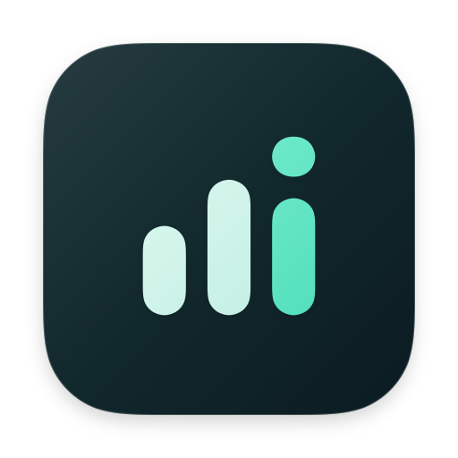

# Flow Quota

macOS 菜单栏流量统计与阈值提醒工具，采用 [MIT 许可证](LICENSE) 开源。

- [下载安装包](https://github.com/leon-wenhao/flow-quota/releases/latest)：Apple 芯片选 `arm64.dmg`，Intel 选 `x86_64.dmg`。
- [安装与更新](INSTALL.md) · [分发与数据说明](DISTRIBUTION.md) · [反馈问题](https://github.com/leon-wenhao/flow-quota/issues)。
- 当前安装包使用 ad-hoc 签名，尚未 Apple 公证；只统计和提醒，不阻断网络。
- 源码和安装包统一在本仓库维护；发布流程见 [发布说明](docs/release-macos.md)。




macOS 原生菜单栏工具：分别观测热点／高成本与普通网络接口总量，并分析各应用流量，配置接口每日总量、短时大流量及应用每日阈值，通过本地通知提醒。当前版本不自动阻断连接。Windows 只保留后续接入入口。

## 当前能力与统计口径

**VPN／代理来源明细目前仅支持 Clash／Mihomo，当前接入的是 Clash Verge 的本地接口。** 其他 VPN／代理，以及未接入该接口的其他 Mihomo 客户端，不会自动显示应用／站点来源拆分或同类 API 明细。普通接口与进程采样仍按各自可观测范围统计，但不代表能识别其他 VPN 内部的真实应用来源。兼容范围见 [Clash 来源说明](docs/mihomo-api.md#兼容范围)。

已接通系统 `nettop` 采样、进程路径归属、SQLite 当日用量与提醒配置、后台服务和原生通知调度。后台大流量预警分别判断接口和每个应用／服务，接口预警不依赖能否识别应用来源。无需安装 NetworkExtension 或修改系统安全设置；开发包使用本地 ad-hoc 签名。

**记录的是连续观测区间内的增量，不是完整自然日账单。** 首次采样建立基线，只有明确在已观测区间内新启动的进程才可计入首批计数。启动前、进程在采样间隔内已退出、睡眠、切网、采样故障等可能漏计。应用按路径归并，代理/TUN、共享系统进程和多网卡场景的归属与重复不能保证。应用合计不等于物理接口或运营商计费流量。

系统报告可用且 `NWPath.isExpensive` 的连接时自动计量（`.expensive`）；高成本信号不等于已确认手机热点、设备或运营商。用户明确手动标记的连接为 `.hotspot`，与高成本网络共用同一应用、当前日用量和提醒预算，切网不重置、不另发额度。普通网络（`.ordinary`）也独立累计，两类总量、应用用量、提醒规则与通知去重互不混合。热点／高成本类新配置默认开启预警，普通网络提醒默认关闭。网络状态不可用（`.unknown`）不分配新增流量。手动热点仅修正当前连接分类，关闭后普通网络仍统计。网络更新会清除手动标记并重新判断。实际采集涵盖 nettop 的 external 接口，不能保证多网卡同时使用时只统计所选路径。

面板顶部可切换“热点／高成本”和“普通网络”，总览、应用明细、图表、预警记录与提醒设置跟随所选类别。菜单栏用量标明当前查看类别；类别切换不改变实际网络归类。schema v5 将已有数据和设置原样归入热点／高成本类，普通网络从启用后的有效采样开始累计，不追溯拆分旧流量。

应用用量、菜单栏前三、时段明细、悬停和上传/下载饼图使用相同来源：Clash 内核的 800MB 可展示为虎牙（Clash）300MB、YouTube（Clash）300MB、其他未识别（Clash）200MB，父项不再重复相加。schema v9 保存当天来源分钟，重启后保留；来源缺失不减去父项和接口总量。按分钟核对，无法核对的分钟完整保留为未识别；旧数据不猜测补填。原始计数及核对集中在用量详情。见 [计算口径](docs/traffic-accounting.md) 与 [实现方案](docs/clash-usage-breakdown.md)。

主图展示独立物理接口总量，范围支持最近一小时、今天和自定义。无观测分钟保持未知，不从日合计回填；来源及接口仍可能有时间/协议差异，不能保证全部字节都能唯一对应应用。源码能力与已发布版本的区别见 `docs/implementation-status.md`。

## 本地构建与运行

要求完整 Xcode。开发环境：Xcode 27.2 / Swift 6.4.2 / macOS SDK 27.2，最低目标 macOS 14。使用系统 SQLite；手动更新依赖锁定 Sparkle 2.10.1。

```sh
./scripts/test-macos.sh
./scripts/build-macos.sh
open ".artifacts/arm64/Flow Quota.app" --args --window
```

默认构建当前架构；Intel 使用 `--x64`；开发 DMG 使用 `--dmg`；优化构建使用 `--release`。`--window` 打开供检查的普通窗口，不传参数时通过菜单栏访问。构建缓存、应用和 DMG 位于忽略的 `.artifacts/` 内。

脚本以项目级 `DEVELOPER_DIR` 选择 `/Applications/Xcode.app/Contents/Developer`，不修改全局 xcode-select。

开发包覆盖更新可能留下旧界面进程或失效的后台注册，不能以文件复制成功代替服务连接恢复。针对 Agent 已停止且没有 nettop 的故障场景，可在构建后运行 `./scripts/install-macos-dev-paused.sh`：整体替换签名包、保存旧包、重新登记安装版并通过系统启动流程修复，完成后保持采集暂停。脚本拒绝替换仍在运行的采集服务；正常采集状态应先完成受控暂停。恢复记录见 `docs/implementation-status.md`「覆盖更新后服务连接异常恢复」。


含两类网络独立统计与提醒的新版 0.1.0（build 2）已安装到 `/Applications/Flow Quota.app`，生产库 v4→v5 升级及暂停状态的真实 XPC 分类账本检查通过，旧数据和设置与备份一致。当前保持暂停，可在采集 Switch 自行恢复；未进行热点实验或真实计量误差验收。详见[验证记录](docs/implementation-status.md)。

## 发布

源码、文档和安装包统一在 `leon-wenhao/flow-quota` 公开，源码采用 MIT，DMG 只作为 Releases 附件。流程见 [公开分发方案](docs/public-distribution-plan.md)、[macOS 发布流程](docs/release-macos.md) 和 [应用内更新设计](docs/in-app-updates.md)。使用 `scripts/set-version.sh` 同步版本，提交并推送后执行 `scripts/release-macos.sh --publish --activate-manifest`。客户端仅在点击“检查更新”时联网，确认后由 Sparkle 校验、替换并重启，无需再次拖拽应用。当前包使用 ad-hoc 签名，未完成 Developer ID 公证，系统仍可能要求额外确认。

## 首次使用与验证

1. 启动完整 `.app`，点击“启用服务并恢复采集”。系统若要求批准后台服务，由用户在登录项设置中批准。重建后旧服务身份失效时，可在设置中使用“修复开发服务”。
2. 等待首次有效采样，应用列表只显示真实采集到且能解析身份的应用/进程。
3. 查看连接状态：系统自动识别高成本网络，无需手动标记。若热点未被识别，可在“通用设置 → 网络分类修正”展开“手动热点”开关，在服务允许时修正当前连接分类。手动标记可取消，切网后需要重新确认；已记录的当日用量保留。
4. 在设置的“后台大流量预警配置”调整三类阈值：默认今日接口 1 GB、最多 5 分钟内接口 200 MB、每个应用／服务 200 MB；短时同来源冷却 10 分钟。每项可单独关闭。主面板“今日流量预警”查看事件及系统调度状态。列表中的应用还可设置独立每日阈值。允许通知并保留主应用运行；不得为验证额外消耗热点流量。
5. 保持主应用运行。关闭面板仍会检查提醒，退出应用会先停止采集。若服务无法确认而选择“仅退出界面”，则后台采集状态未知且不再发送提醒。再次启用服务可恢复。

接口与应用分别约每 2 秒采样；应用完整帧发布另有一个周期的延迟，主应用默认每次请求结束后等待 5 秒刷新，可在「设置 → 通用 → 用量刷新间隔」改为 1–5 秒，自动保存，从下一轮等待生效；该间隔同时影响菜单栏和通知检查，不改变后台采样周期。通知在观测到越线后调度，不保证精确到达阈值的瞬间。权限拒绝、专注模式及系统调度可影响展示；成功提交系统不代表横幅已被用户看见。

规则保存 ACK 表示提醒配置已持久化；不代表流量拦截。未获通知授权或调度失败不会记录已确认提醒。当前开发包没有过滤扩展，未来自动阻断另按 NetworkExtension 要求实施。

详见 [后台大流量预警设计与验收](docs/traffic-alerts.md) 和 [系统来源分类依据](docs/system-process-classification.md)。当天事件只保留最多 256 条，未授权通知仍记录事件，但不确认已发送。

## 模块结构

| 模块 | 职责 |
| --- | --- |
| macos/Sources/FlowQuotaApp | SwiftUI、后台刷新、阈值编辑、通知授权和调度 |
| macos/Sources/FlowQuotaCore | 单位、日期、规则、提醒协议及未来预算规则 |
| macos/Sources/FlowQuotaStore | SQLite 单写入、迁移、批量增量入账和通知去重 |
| macos/Sources/FlowQuotaPlatform | 身份校验 XPC、nettop 子进程、解析、进程归属与采样基线 |
| macos/Sources/FlowQuotaAgent | 独立采集生命周期、真实快照和持久化规则 |
| shared/test-vectors | 后续两端共用的额度测试向量 |
| windows | 后续接入说明，无应用或驱动 |

UI 不直接读写数据库。数据目录为 `~/Library/Application Support/FlowQuota/`：目录 0700，数据库及 sidecar 0600；拒绝不安全路径和链接。源码 schema v6：v3 独立保存按日接口总量，v5 隔离两类网络账本，v6 增加当天接口分钟汇总。事务迁移保留旧账本；不将应用合计当作接口历史。

## 接续开发

先读 [AGENTS.md](AGENTS.md)、[实际验证记录](docs/implementation-status.md) 与 [提醒版任务](docs/tasks/005-reminder-monitor.md)。

相关说明：[执行计划](docs/execution-plan.md)、[产品设计](docs/flow-quota-v1-设计方案.md)、[数据库设计](docs/database-design.md)、[界面](docs/ui-implementation.md)、[官方依据](docs/official-references.md)、[未来过滤任务](docs/tasks/002-real-filter.md)。旧设计中的自动阻断不属于本轮交付。

### Mac 总流量与应用来源

菜单栏、应用列表概览和分时主图均显示物理接口的完整观测总量，来源识别失败也不减少。应用及系统服务全部保留，包括“Clash 代理内核（来源应用待确认）”；Clash 识别来源另列，不与内核重复相加。上传／下载的未识别或计量差额直接说明，不能猜成某个应用，也不缩放数字来凑总数。应用阈值仍依据各自进程观测，接口预警独立判断。计算、展示与限制见 [流量总量与应用来源](docs/traffic-accounting.md)。

接口不可确定、计数读取失败或采样间断时显示原因；新接口首帧只建基线，不从旧应用合计推算接口历史。接口总量包含本机接口上的局域网通信和协议开销，不覆盖手机自身或其他热点设备，也不等同运营商账单。

本轮按用户要求仅做模拟计数、临时数据库、编译和签名检查；没有热点流量实验、下载测速或运营商对照测试。真实接口及长期误差仍待非热点环境下的后续验收。

### 无采集的开发服务自检

仅开发包使用 `--repair-agent-paused` / `--verify-agent-paused`。冷启动修复前须为本用户 launchd 设置 `FLOW_QUOTA_VERIFY_PAUSED=1`，并将同一变量传给修复进程；自检后恢复原 launchd 环境。只传 `--repair-agent-paused` 不会保证 helper 冷启动暂停，因此客户端会先检查专用环境。该路径验证注册、XPC 和数据迁移，不验证网络计量；正常使用的启动入口保持原行为。完整操作记录见上述验证文档。
