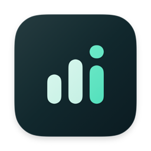

# Flow Quota

macOS 原生菜单栏流量工具：查看本机用量、分析应用来源，并在达到阈值时收到通知。**当前版本只统计与提醒，不阻断连接或限制网速。**

[下载最新发布版](https://github.com/leon-wenhao/flow-quota-releases/releases/latest) · [安装与更新](INSTALL.md) · [分发与数据说明](DISTRIBUTION.md) · [问题反馈](https://github.com/leon-wenhao/flow-quota-releases/issues)

## 下载

需要 **macOS 14 或更高版本**，按 Mac 的处理器选择 Release 附件：

| Mac 类型 | DMG 文件名中的架构标识 |
| --- | --- |
| Apple 芯片（M 系列） | `arm64` |
| Intel 处理器 | `x86_64` |

可在苹果菜单 →「关于本机」查看芯片或处理器。可用安装包以发布页实际附件为准。

当前安装包使用 **ad-hoc 开发签名，尚未完成 Developer ID 签名与 Apple 公证**。首次打开可能被系统拦截，请先阅读[安装说明](INSTALL.md)。

## 可以做什么

- **今日用量**：菜单栏快速概览，分别查看「热点／高成本网络」和「普通网络」的接口总量及应用用量，两类独立累计、独立设置提醒。
- **分时图表**：查看当天应用分钟归因汇总；在所选时段内比较上传／下载堆叠柱与对应应用占比。未观测时段与已观测零用量分开表示。
- **阈值通知**：配置接口每日总量、接口短时、各应用／服务短时预警，以及应用每日用量提醒；需要允许系统通知并保持主应用运行。
- **Clash 来源**：在有可靠识别信息时展示「站点（Clash）」等标签，帮助理解经 Clash／Mihomo 处理的来源。

## 阅读数据前

「高成本网络」是系统的成本信号，**不等于已确认连接手机热点**；手动热点标记用于修正当前连接分类。切换查看类别不会改变当前连接归类。

用量只覆盖采集服务运行期间的有效观测区间。启动、重启、睡眠、暂停、切网及采样间断可能留下未知流量，不追溯补齐。接口总量来自独立物理接口计量；应用归因可能重叠，应用合计不等于接口总量，也不等于运营商账单。

统计与事件仅保留本机当前自然日，规则和偏好持续保存；跨日清理及 Clash 内存数据的边界见[分发与数据说明](DISTRIBUTION.md)。

## 关于本仓库

本仓库用于 **Flow Quota 闭源应用的安装包分发、公开文档和 Issues 反馈**，不提供应用源代码。GitHub 自动生成的 **Source code (zip / tar.gz)** 仅打包本公开仓库的文档与公开资源，不含应用源代码，也不是安装包；安装请选择 `.dmg`。

Flow Quota 的版权由权利人保留。本仓库未授予应用源码的开源许可；公开下载不代表授予修改或再分发许可。详见[分发说明](DISTRIBUTION.md)。
